# Failure traces: `todo`

Generated 2026-10-27 from fresh verification audits of every todo ticket: Ticket #3 ✅ VERIFIED, Ticket #4 ✅ VERIFIED, Ticket #5 ✅ VERIFIED, Ticket #6 ✅ VERIFIED.
Every failed check has a trace: a screenshot, the DOM at that moment, the inputs and console output just before it.
They are grouped **by cause**, across tickets. Each group's first failure is the direct hit; the rest are knock-on failures.

| # | Cause | Kind | Tickets | Failures | Direct hit |
|---|---|---|---|---|---|
| C1 | "a todo app with a simple interface" | broken on purpose | #3 AC1 | 3 | "empty state shown when there are no tasks" |
| C2 | "using a client side db" / "Everything should work on client side" | broken on purpose | #3 AC2, #5 AC2 | 22 | "mark a task done" |
| C3 | "create a task" | broken on purpose | #3 AC3 | 4 | "create a task" |
| C4 | "mark it done" | broken on purpose | #3 AC4 | 12 | "mark a task done" |
| C5 | "delete it" | broken on purpose | #3 AC5 | 16 | "delete a task" |
| C6 | "add filters only see completed, incomplete and all tasks" | broken on purpose | #4 AC1 | 6 | "Completed filter shows only completed tasks" (expected `Pay rent`, got `Pay rent\|Call bank\|Plan trip\|Read book\|Fix bug`) |
| C7 | "add a due date" | broken on purpose | #4 AC2 | 2 | "due date is stored with the task" |
| C8 | "add tags to my ticket" | broken on purpose | #4 AC3 | 3 | "tags are trimmed, lowercased and de-duplicated" |
| C9 | "filter the tasks by available tags" | broken on purpose | #4 AC4 | 5 | "clicking a tag shows only tasks with that tag" |
| C10 | Due dates are date-only, with overdue tasks highlighted | broken on purpose | #4 AC5 | 2 | "past-due incomplete task is marked Overdue" |
| C11 | Tasks are sorted by due date | broken on purpose | #4 AC6 | 7 | "tasks sort by due date, undated last" (expected `Pay rent\|Call bank\|Plan trip\|Read book`, got `Read book\|Plan trip\|Call bank\|Pay rent`) |
| C12 | Tags (and the due date) can be edited after creation | broken on purpose | #4 AC7 | 16 | "mark a task done" |
| C13 | "create recurring tasks for my todo app" | broken on purpose | #5 AC1 | 3 | "repeating task shows its schedule" |
| C14 | Repeat every N days, weeks, months or years | broken on purpose | #5 AC3 | 4 | "every 3 days crosses a month boundary" |
| C15 | The next date follows the schedule, not the day it was completed | broken on purpose | #5 AC4 | 2 | "overdue schedule skips ahead to today or later" |
| C16 | A task repeats until its repeat is edited | broken on purpose | #5 AC5 | 22 | "mark a task done" |
| C17 | "Add a priority attribute to the todo task" | broken on purpose | #6 AC1 | 11 | "priority is shown on the task as a chip" |
| C18 | "Configure the filters" | broken on purpose | #6 AC2 | 3 | "priority filter shows only tasks of that priority" (expected `Fix outage\|Someday idea`, got `Old bill\|Fix outage\|Plan meeting\|Tidy desk\|Someday idea\|Default task`) |
| C19 | "add" | broken on purpose | #6 AC3 | 11 | "priority is stored with the task" |
| C20 | "edit functionality as well" | broken on purpose | #6 AC4 | 6 | "priority filter shows only tasks of that priority" (expected `Fix outage\|Someday idea`, got `Fix outage`) |
| C21 | Three levels (High, Medium, Low); new tasks and tasks saved before priorities existed are Medium | broken on purpose | #6 AC5 | 1 | "tasks saved before priorities existed show as Medium" |
| C22 | Sort stays due date first; on the same date, priority breaks the tie (High first) | broken on purpose | #6 AC6 | 3 | "same due date: High sorts before Medium before Low" (expected `Fix outage\|Plan meeting\|Tidy desk\|Default task`, got `Fix outage\|Tidy desk\|Plan meeting\|Default task`) |

## Real failures (fresh runs)

None: every ticket's fresh run passed, so every failure below was caused on purpose by the audit.

## Failures caused on purpose (one group per way of breaking the app)

### C1 · "a todo app with a simple interface"

Broken by `Object.defineProperty(emptyState, 'textContent', { get: () => '', set() {} });`, in Ticket #3 AC1.

**Ticket #3 AC1:** 3 failures.

- Direct hit: "empty state shown when there are no tasks"
- Knock-on (2): "no-match message when filters hide everything"; "empty state returns after clearing all tasks"

### C2 · "using a client side db" / "Everything should work on client side"

Broken by `const upd0 = taskStore.update; taskStore.update = (d, t) => upd0(d, { ...t, done: false });`, in Ticket #3 AC2 and Ticket #5 AC2.

**Ticket #3 AC2:** 11 failures.

- Direct hit: "mark a task done"
- Knock-on (10): "summary counts remaining tasks" (expected `1 of 2 remaining`, got `2 of 2 remaining`); "changes are persisted in IndexedDB"; "completed tasks are never flagged overdue"; "Completed filter shows only completed tasks" (expected `Pay rent`, got ``); "Incomplete filter shows only incomplete tasks" (expected `Call bank\|Plan trip\|Read book\|Fix bug`, got `Pay rent\|Call bank\|Plan trip\|Read book\|Fix bug`); "summary notes how many are shown when filtered" (expected `4 of 5 remaining · showing 4`, got `5 of 5 remaining · showing 5`); "All filter shows every task"; "tag filter combines with the status filter" (expected `Call bank`, got `Pay rent\|Call bank`); "completed occurrence stays as done history"; test threw: TypeError: Cannot read properties of undefined (reading 'querySelector')

**Ticket #5 AC2:** 11 failures.

- Direct hit: "mark a task done"
- Knock-on (10): "summary counts remaining tasks" (expected `1 of 2 remaining`, got `2 of 2 remaining`); "changes are persisted in IndexedDB"; "completed tasks are never flagged overdue"; "Completed filter shows only completed tasks" (expected `Pay rent`, got ``); "Incomplete filter shows only incomplete tasks" (expected `Call bank\|Plan trip\|Read book\|Fix bug`, got `Pay rent\|Call bank\|Plan trip\|Read book\|Fix bug`); "summary notes how many are shown when filtered" (expected `4 of 5 remaining · showing 4`, got `5 of 5 remaining · showing 5`); "All filter shows every task"; "tag filter combines with the status filter" (expected `Call bank`, got `Pay rent\|Call bank`); "completed occurrence stays as done history"; test threw: TypeError: Cannot read properties of undefined (reading 'querySelector')

### C3 · "create a task"

Broken by `taskStore.add = async () => {};`, in Ticket #3 AC3.

**Ticket #3 AC3:** 4 failures.

- Direct hit: "create a task"
- Knock-on (3): "create a second task"; "empty state hidden once tasks exist"; test threw: TypeError: Cannot read properties of undefined (reading 'querySelector')

### C4 · "mark it done"

Broken by `setDone = async () => {};`, in Ticket #3 AC4.

**Ticket #3 AC4:** 12 failures.

- Direct hit: "mark a task done"
- Knock-on (11): "summary counts remaining tasks" (expected `1 of 2 remaining`, got `2 of 2 remaining`); "changes are persisted in IndexedDB"; "completed tasks are never flagged overdue"; "Completed filter shows only completed tasks" (expected `Pay rent`, got ``); "Incomplete filter shows only incomplete tasks" (expected `Call bank\|Plan trip\|Read book\|Fix bug`, got `Pay rent\|Call bank\|Plan trip\|Read book\|Fix bug`); "summary notes how many are shown when filtered" (expected `4 of 5 remaining · showing 4`, got `5 of 5 remaining · showing 5`); "All filter shows every task"; "tag filter combines with the status filter" (expected `Call bank`, got `Pay rent\|Call bank`); "completing a repeating task creates the next occurrence"; "completed occurrence stays as done history"; test threw: TypeError: Cannot read properties of undefined (reading 'done')

### C5 · "delete it"

Broken by `taskStore.remove = async () => {};`, in Ticket #3 AC5.

**Ticket #3 AC5:** 16 failures.

- Direct hit: "delete a task"
- Knock-on (15): "changes are persisted in IndexedDB"; "tasks sort by due date, undated last" (expected `Pay rent\|Call bank\|Plan trip\|Read book`, got `Pay rent\|Call bank\|Plan trip\|Buy milk\|<b>Write report</b>\|Read book`); "Incomplete filter shows only incomplete tasks" (expected `Call bank\|Plan trip\|Read book\|Fix bug`, got `Call bank\|Plan trip\|Buy milk\|<b>Write report</b>\|Read book\|Fix bug\|Tag test`); "summary notes how many are shown when filtered" (expected `4 of 5 remaining · showing 4`, got `7 of 8 remaining · showing 7`); "All filter shows every task"; "clicking the selected tag again clears the tag filter"; "All tags chip clears the tag filter"; "deleting a tag's last task clears that tag filter"; "tasks without dueDate/tags still render"; "same due date: High sorts before Medium before Low" (expected `Fix outage\|Plan meeting\|Tidy desk\|Default task`, got `Water plants\|Pay rent\|Fix outage\|Call bank\|Stand-up notes\|Plan meeting\|Tidy desk\|Read book\|Plan trip\|Water plants\|Buy milk\|<b>Write report</b>\|Fix bug\|Tag test\|Legacy task\|Default task`); "due date still sorts before priority" (expected `Old bill\|Fix outage\|Plan meeting\|Tidy desk\|Someday idea\|Default task`, got `Water plants\|Pay rent\|Old bill\|Fix outage\|Call bank\|Stand-up notes\|Plan meeting\|Tidy desk\|Read book\|Plan trip\|Water plants\|Someday idea\|Buy milk\|<b>Write report</b>\|Fix bug\|Tag test\|Legacy task\|Default task`); "summary notes how many are shown when a priority filter is on" (expected `4 of 6 remaining · showing 2`, got `13 of 18 remaining · showing 2`); "Any priority clears the priority filter"; "an edited priority re-sorts the task" (expected `Old bill\|Fix outage\|Tidy desk\|Plan meeting\|Someday idea\|Default task`, got `Water plants\|Pay rent\|Old bill\|Fix outage\|Tidy desk\|Call bank\|Stand-up notes\|Plan meeting\|Read book\|Plan trip\|Water plants\|Someday idea\|Buy milk\|<b>Write report</b>\|Fix bug\|Tag test\|Legacy task\|Default task`); "empty state returns after clearing all tasks"

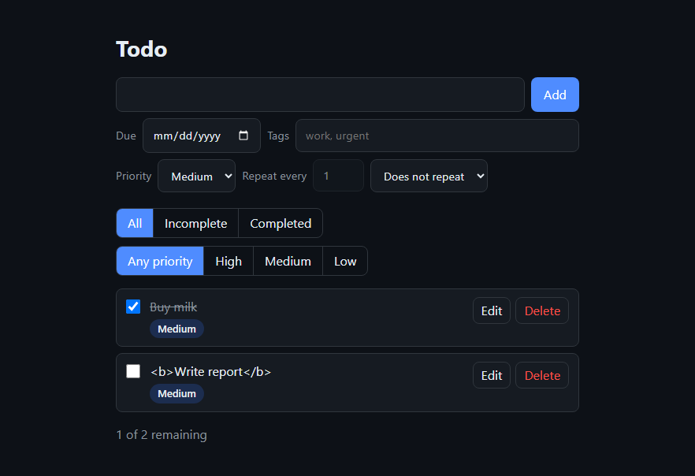

### C6 · "add filters only see completed, incomplete and all tasks"

Broken by `statusFilter.addEventListener('click', (e) => e.stopImmediatePropagation(), true);`, in Ticket #4 AC1.

**Ticket #4 AC1:** 6 failures.

- Direct hit: "Completed filter shows only completed tasks" (expected `Pay rent`, got `Pay rent\|Call bank\|Plan trip\|Read book\|Fix bug`)
- Knock-on (5): "Incomplete filter shows only incomplete tasks" (expected `Call bank\|Plan trip\|Read book\|Fix bug`, got `Pay rent\|Call bank\|Plan trip\|Read book\|Fix bug`); "summary notes how many are shown when filtered" (expected `4 of 5 remaining · showing 4`, got `4 of 5 remaining`); "tag filter combines with the status filter" (expected `Call bank`, got `Pay rent\|Call bank`); "no-match message when filters hide everything"; "priority filter combines with the status and tag filters"

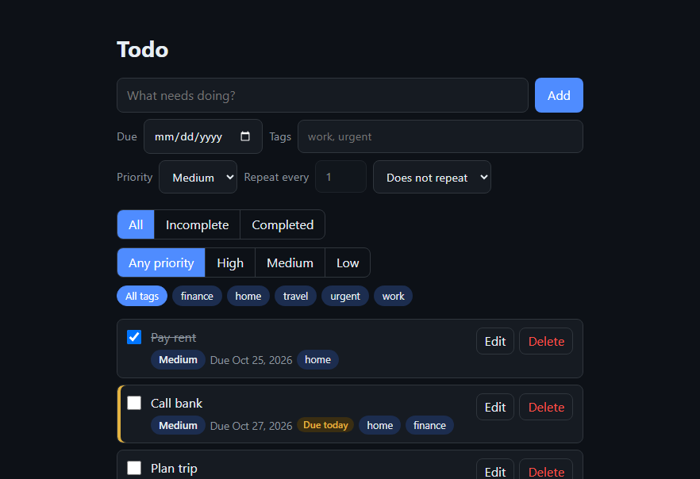

### C7 · "add a due date"

Broken by `const add0 = taskStore.add; taskStore.add = (d, t) => add0(d, { ...t, dueDate: null });`, in Ticket #4 AC2.

**Ticket #4 AC2:** 2 failures.

- Direct hit: "due date is stored with the task"
- Knock-on (1): test threw: TypeError: Cannot read properties of null (reading 'textContent')

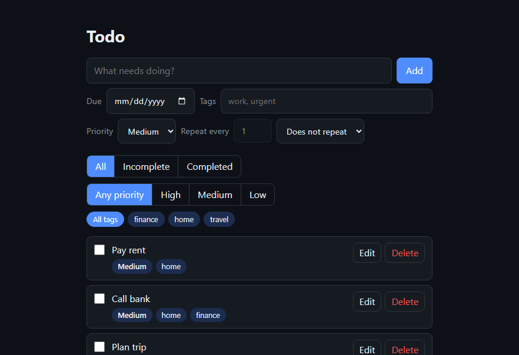

### C8 · "add tags to my ticket"

Broken by `parseTags = () => [];`, in Ticket #4 AC3.

**Ticket #4 AC3:** 3 failures.

- Direct hit: "tags are trimmed, lowercased and de-duplicated"
- Knock-on (2): "tag filter lists every tag in use, sorted"; test threw: TypeError: Cannot read properties of null (reading 'textContent')

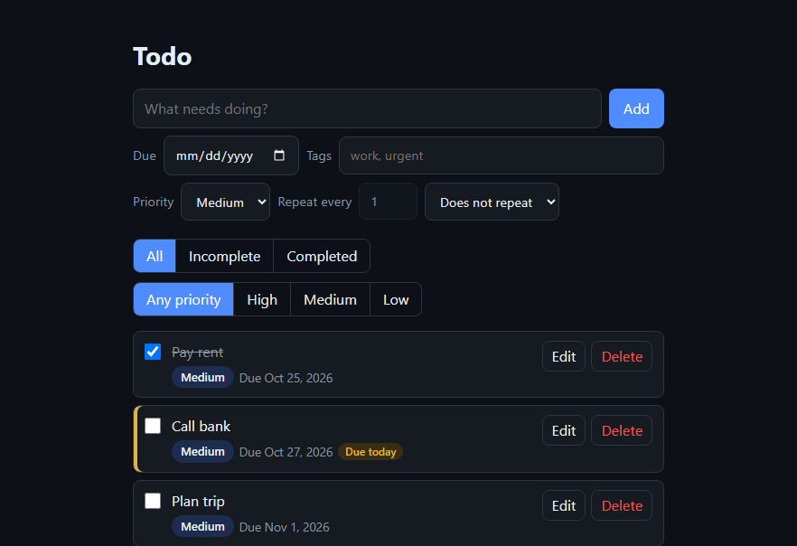

### C9 · "filter the tasks by available tags"

Broken by `tagFilter.addEventListener('click', (e) => e.stopImmediatePropagation(), true);`, in Ticket #4 AC4.

**Ticket #4 AC4:** 5 failures.

- Direct hit: "clicking a tag shows only tasks with that tag"
- Knock-on (4): "selected tag chip is marked pressed"; "tag filter combines with the status filter" (expected `Call bank`, got `Call bank\|Plan trip\|Read book\|Fix bug`); "no-match message when filters hide everything"; "priority filter combines with the status and tag filters"

### C10 · Due dates are date-only, with overdue tasks highlighted

Broken by `dueStatus = () => null;`, in Ticket #4 AC5.

**Ticket #4 AC5:** 2 failures.

- Direct hit: "past-due incomplete task is marked Overdue"
- Knock-on (1): "task due today is marked Due today"

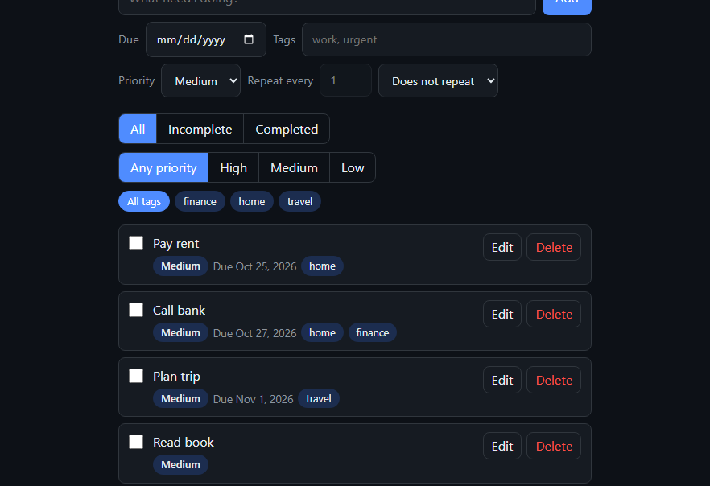

### C11 · Tasks are sorted by due date

Broken by `compareTasks = (a, b) => b.createdAt - a.createdAt;`, in Ticket #4 AC6.

**Ticket #4 AC6:** 7 failures.

- Direct hit: "tasks sort by due date, undated last" (expected `Pay rent\|Call bank\|Plan trip\|Read book`, got `Read book\|Plan trip\|Call bank\|Pay rent`)
- Knock-on (6): "Incomplete filter shows only incomplete tasks" (expected `Call bank\|Plan trip\|Read book\|Fix bug`, got `Fix bug\|Read book\|Plan trip\|Call bank`); "clicking a tag shows only tasks with that tag"; "same due date: High sorts before Medium before Low" (expected `Fix outage\|Plan meeting\|Tidy desk\|Default task`, got `Plan meeting\|Tidy desk\|Fix outage\|Default task`); "due date still sorts before priority" (expected `Old bill\|Fix outage\|Plan meeting\|Tidy desk\|Someday idea\|Default task`, got `Old bill\|Someday idea\|Plan meeting\|Tidy desk\|Fix outage\|Default task`); "priority filter shows only tasks of that priority" (expected `Fix outage\|Someday idea`, got `Someday idea\|Fix outage`); "an edited priority re-sorts the task" (expected `Old bill\|Fix outage\|Tidy desk\|Plan meeting\|Someday idea\|Default task`, got `Old bill\|Someday idea\|Plan meeting\|Tidy desk\|Fix outage\|Default task`)

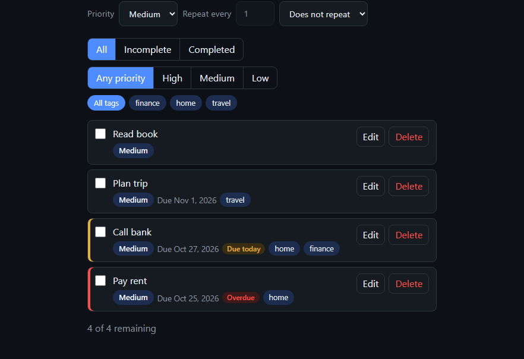

### C12 · Tags (and the due date) can be edited after creation

Broken by `taskStore.update = async () => {};`, in Ticket #4 AC7.

**Ticket #4 AC7:** 16 failures.

- Direct hit: "mark a task done"
- Knock-on (15): "summary counts remaining tasks" (expected `1 of 2 remaining`, got `2 of 2 remaining`); "changes are persisted in IndexedDB"; "completed tasks are never flagged overdue"; "Completed filter shows only completed tasks" (expected `Pay rent`, got ``); "Incomplete filter shows only incomplete tasks" (expected `Call bank\|Plan trip\|Read book\|Fix bug`, got `Pay rent\|Call bank\|Plan trip\|Read book\|Fix bug`); "summary notes how many are shown when filtered" (expected `4 of 5 remaining · showing 4`, got `5 of 5 remaining · showing 5`); "All filter shows every task"; "tag filter combines with the status filter" (expected `Call bank`, got `Pay rent\|Call bank`); "Save updates the due date and tags"; "edits are persisted"; "edited task moves to its due-date position"; "Cancel discards edits"; "tasks without dueDate/tags still render"; "completed occurrence stays as done history"; test threw: TypeError: Cannot read properties of undefined (reading 'querySelector')

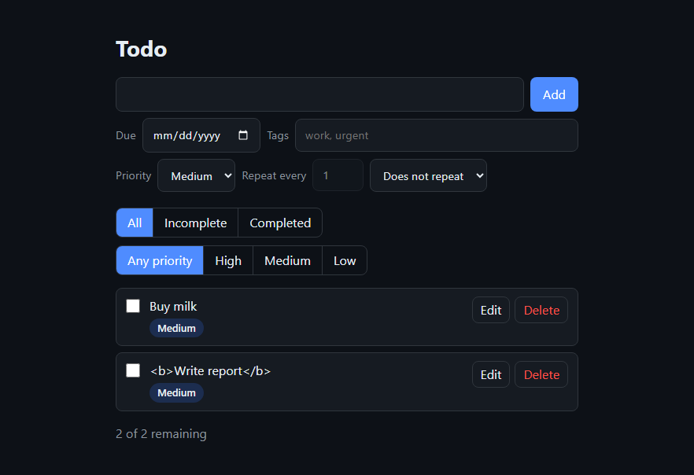

### C13 · "create recurring tasks for my todo app"

Broken by `repeatLabel = () => '';`, in Ticket #5 AC1.

**Ticket #5 AC1:** 3 failures.

- Direct hit: "repeating task shows its schedule"
- Knock-on (2): "singular label for an interval of 1"; "editing changes the repeat"

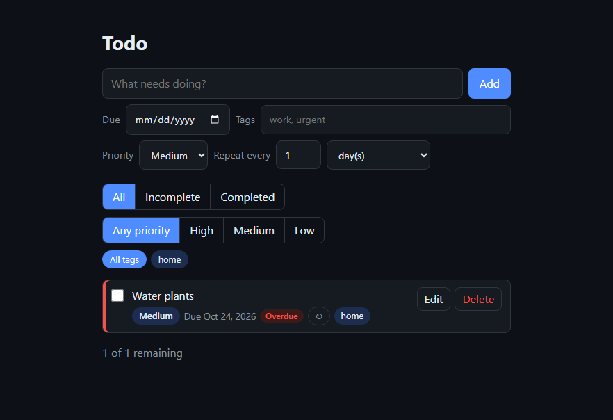

### C14 · Repeat every N days, weeks, months or years

Broken by `const add1 = addInterval; addInterval = (d, r) => add1(d, { ...r, every: 1 });`, in Ticket #5 AC3.

**Ticket #5 AC3:** 4 failures.

- Direct hit: "every 3 days crosses a month boundary"
- Knock-on (3): "every 2 weeks: +14 days"; "every 3 months rolls over the year"; "next occurrence is open, on schedule, with the same tags and repeat"

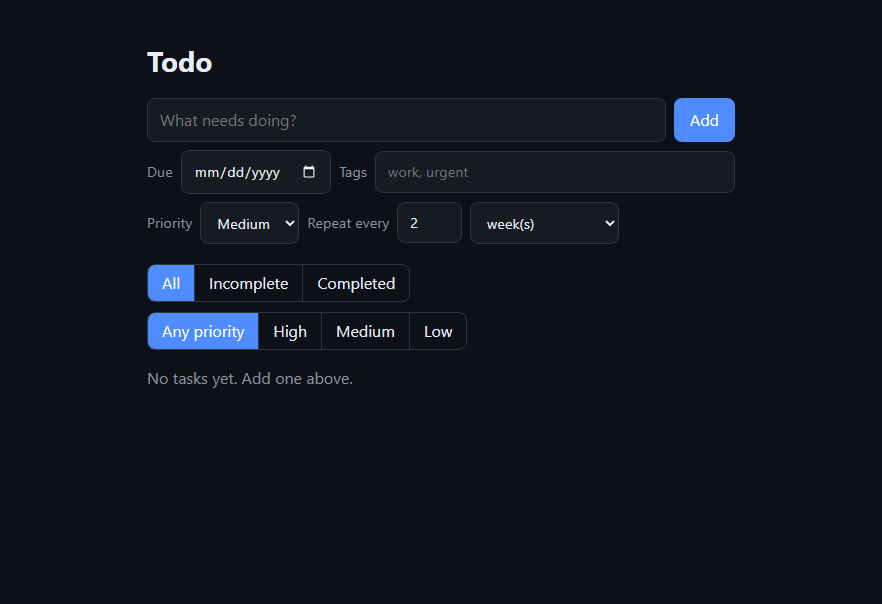

### C15 · The next date follows the schedule, not the day it was completed

Broken by `nextDueDate = (d, r) => addInterval(d, r);`, in Ticket #5 AC4.

**Ticket #5 AC4:** 2 failures.

- Direct hit: "overdue schedule skips ahead to today or later"
- Knock-on (1): "next date is today when the schedule lands on today"

### C16 · A task repeats until its repeat is edited

Broken by `const pr0 = parseRepeat; parseRepeat = (u, e, d) => pr0(u \|\| 'day', e, d \|\| todayISO());`, in Ticket #5 AC5.

**Ticket #5 AC5:** 22 failures.

- Direct hit: "mark a task done"
- Knock-on (21): "summary counts remaining tasks" (expected `1 of 2 remaining`, got `2 of 3 remaining`); "delete a task"; "changes are persisted in IndexedDB"; "mark a task not done again"; "Incomplete filter shows only incomplete tasks" (expected `Call bank\|Plan trip\|Read book\|Fix bug`, got `Call bank\|Pay rent\|Plan trip\|Read book\|Fix bug`); "summary notes how many are shown when filtered" (expected `4 of 5 remaining · showing 4`, got `5 of 6 remaining · showing 5`); "All filter shows every task"; "clicking a tag shows only tasks with that tag"; "tag filter combines with the status filter" (expected `Call bank`, got `Call bank\|Pay rent`); "clicking the selected tag again clears the tag filter"; "All tags chip clears the tag filter"; "deleting a tag's last task clears that tag filter"; "'Does not repeat' gives no rule"; "'Does not repeat' stops repeating"; "completing a non-repeating task creates nothing new"; "repeat rules are persisted"; "priority filter shows only tasks of that priority" (expected `Fix outage\|Someday idea`, got `Fix outage\|Someday idea\|Someday idea`); "summary notes how many are shown when a priority filter is on" (expected `4 of 6 remaining · showing 2`, got `6 of 8 remaining · showing 3`); "priority filter combines with the status and tag filters"; "Any priority clears the priority filter"; "an edited priority re-sorts the task" (expected `Old bill\|Fix outage\|Tidy desk\|Plan meeting\|Someday idea\|Default task`, got `Old bill\|Fix outage\|Tidy desk\|Plan meeting\|Old bill\|Someday idea\|Someday idea\|Default task`)

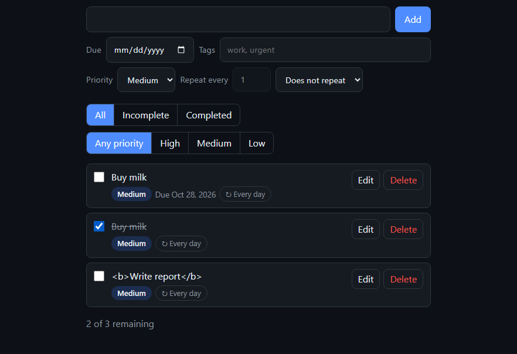

### C17 · "Add a priority attribute to the todo task"

Broken by `const n0 = normalize; normalize = (t) => ({ ...n0(t), priority: 'medium' });`, in Ticket #6 AC1.

**Ticket #6 AC1:** 11 failures.

- Direct hit: "priority is shown on the task as a chip"
- Knock-on (10): "new task form sets the priority"; "same due date: High sorts before Medium before Low" (expected `Fix outage\|Plan meeting\|Tidy desk\|Default task`, got `Fix outage\|Tidy desk\|Plan meeting\|Default task`); "due date still sorts before priority" (expected `Old bill\|Fix outage\|Plan meeting\|Tidy desk\|Someday idea\|Default task`, got `Old bill\|Fix outage\|Tidy desk\|Plan meeting\|Default task\|Someday idea`); "priority filter shows only tasks of that priority" (expected `Fix outage\|Someday idea`, got ``); "summary notes how many are shown when a priority filter is on" (expected `4 of 6 remaining · showing 2`, got `4 of 6 remaining · showing 0`); "priority filter combines with the status and tag filters"; "edit form shows the current priority"; "editing changes the priority and persists it"; "an edited priority re-sorts the task" (expected `Old bill\|Fix outage\|Tidy desk\|Plan meeting\|Someday idea\|Default task`, got `Old bill\|Fix outage\|Tidy desk\|Plan meeting\|Default task\|Someday idea`); "a repeating task's next occurrence keeps its priority"

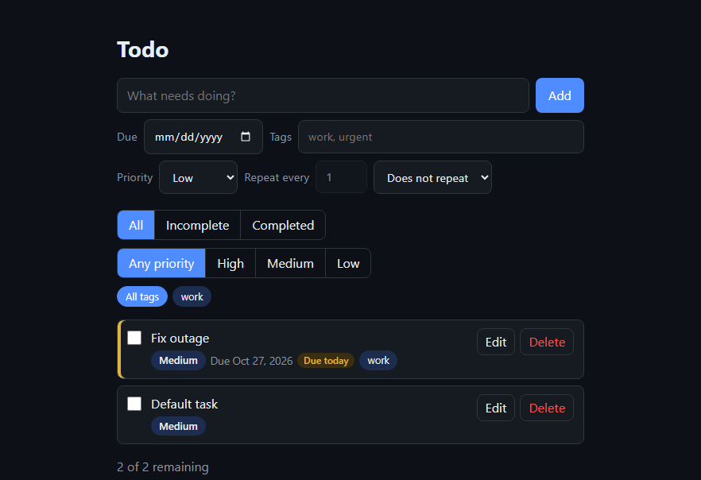

### C18 · "Configure the filters"

Broken by `priorityFilter.addEventListener('click', (e) => e.stopImmediatePropagation(), true);`, in Ticket #6 AC2.

**Ticket #6 AC2:** 3 failures.

- Direct hit: "priority filter shows only tasks of that priority" (expected `Fix outage\|Someday idea`, got `Old bill\|Fix outage\|Plan meeting\|Tidy desk\|Someday idea\|Default task`)
- Knock-on (2): "summary notes how many are shown when a priority filter is on" (expected `4 of 6 remaining · showing 2`, got `4 of 6 remaining`); "priority filter combines with the status and tag filters"

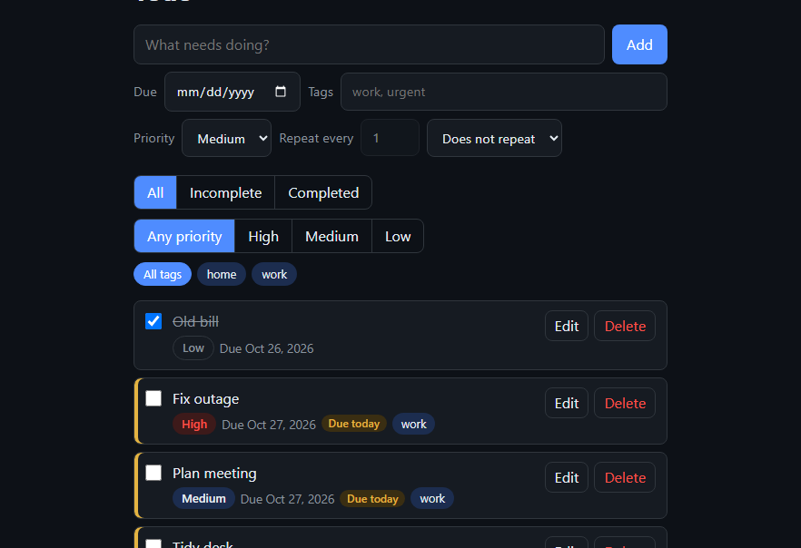

### C19 · "add"

Broken by `const add2 = taskStore.add; taskStore.add = (d, t) => add2(d, { ...t, priority: 'medium' });`, in Ticket #6 AC3.

**Ticket #6 AC3:** 11 failures.

- Direct hit: "priority is stored with the task"
- Knock-on (10): "priority is shown on the task as a chip"; "new task form sets the priority"; "same due date: High sorts before Medium before Low" (expected `Fix outage\|Plan meeting\|Tidy desk\|Default task`, got `Fix outage\|Tidy desk\|Plan meeting\|Default task`); "due date still sorts before priority" (expected `Old bill\|Fix outage\|Plan meeting\|Tidy desk\|Someday idea\|Default task`, got `Old bill\|Fix outage\|Tidy desk\|Plan meeting\|Default task\|Someday idea`); "priority filter shows only tasks of that priority" (expected `Fix outage\|Someday idea`, got ``); "summary notes how many are shown when a priority filter is on" (expected `4 of 6 remaining · showing 2`, got `4 of 6 remaining · showing 0`); "priority filter combines with the status and tag filters"; "edit form shows the current priority"; "an edited priority re-sorts the task" (expected `Old bill\|Fix outage\|Tidy desk\|Plan meeting\|Someday idea\|Default task`, got `Old bill\|Tidy desk\|Fix outage\|Plan meeting\|Default task\|Someday idea`); "a repeating task's next occurrence keeps its priority"

### C20 · "edit functionality as well"

Broken by `const upd2 = taskStore.update; taskStore.update = (d, t) => upd2(d, { ...t, priority: undefined });`, in Ticket #6 AC4.

**Ticket #6 AC4:** 6 failures.

- Direct hit: "priority filter shows only tasks of that priority" (expected `Fix outage\|Someday idea`, got `Fix outage`)
- Knock-on (5): "summary notes how many are shown when a priority filter is on" (expected `4 of 6 remaining · showing 2`, got `4 of 6 remaining · showing 1`); "priority filter combines with the status and tag filters"; "editing changes the priority and persists it"; "an edited priority re-sorts the task" (expected `Old bill\|Fix outage\|Tidy desk\|Plan meeting\|Someday idea\|Default task`, got `Old bill\|Fix outage\|Tidy desk\|Plan meeting\|Default task\|Someday idea`); "a repeating task's next occurrence keeps its priority"

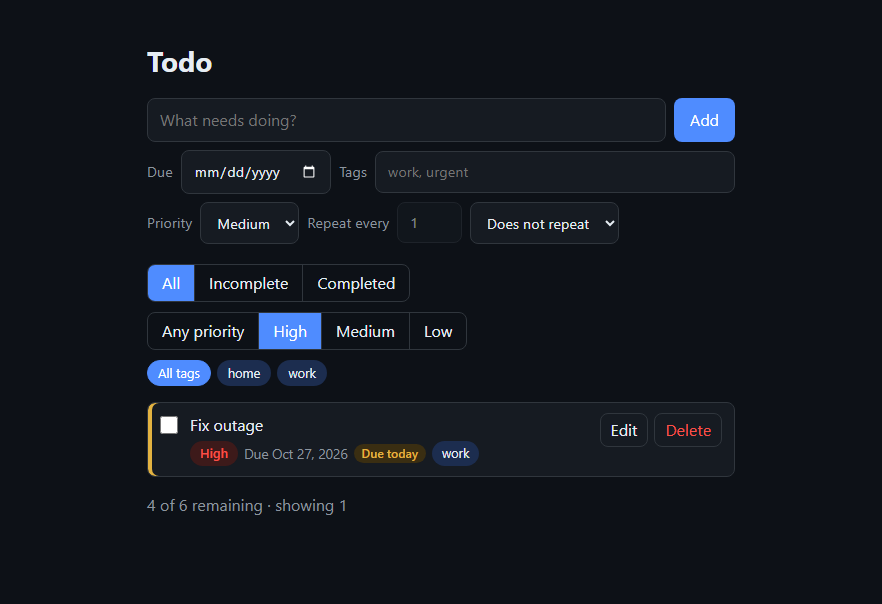

### C21 · Three levels (High, Medium, Low); new tasks and tasks saved before priorities existed are Medium

Broken by `const pp0 = parsePriority; parsePriority = (v) => (v ? pp0(v) : 'low');`, in Ticket #6 AC5.

**Ticket #6 AC5:** 1 failure.

- Direct hit: "tasks saved before priorities existed show as Medium"

### C22 · Sort stays due date first; on the same date, priority breaks the tie (High first)

Broken by `compareTasks = (a, b) => (a.dueDate === b.dueDate ? a.createdAt - b.createdAt : !a.dueDate ? 1 : !b.dueDate ? -1 : a.dueDate < b.dueDate ? -1 : 1);`, in Ticket #6 AC6.

**Ticket #6 AC6:** 3 failures.

- Direct hit: "same due date: High sorts before Medium before Low" (expected `Fix outage\|Plan meeting\|Tidy desk\|Default task`, got `Fix outage\|Tidy desk\|Plan meeting\|Default task`)
- Knock-on (2): "due date still sorts before priority" (expected `Old bill\|Fix outage\|Plan meeting\|Tidy desk\|Someday idea\|Default task`, got `Old bill\|Fix outage\|Tidy desk\|Plan meeting\|Default task\|Someday idea`); "an edited priority re-sorts the task" (expected `Old bill\|Fix outage\|Tidy desk\|Plan meeting\|Someday idea\|Default task`, got `Old bill\|Fix outage\|Tidy desk\|Plan meeting\|Default task\|Someday idea`)

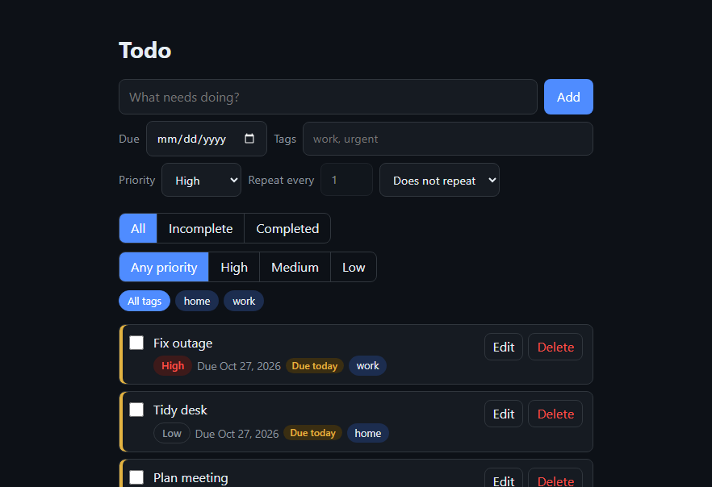

---
Full traces (every screenshot, DOM snapshot and `failures.html` per ticket): `C:\Users\qadiaabd\AppData\Local\Temp\claude\d--OneDrive---PERSEUS-MANAGEMENT-GROUP-INC-Desktop-AI-Hackathon-contour-jonas-oct-2026-qa-abdul-qadir\a9f95cf2-16c0-4b3b-bdb1-f92231cb6e95\scratchpad\pf-todo`.
Regenerate: `node .claude/skills/factory-loop/scripts/project-failures.js --project todo --out todo/failure-traces`.
